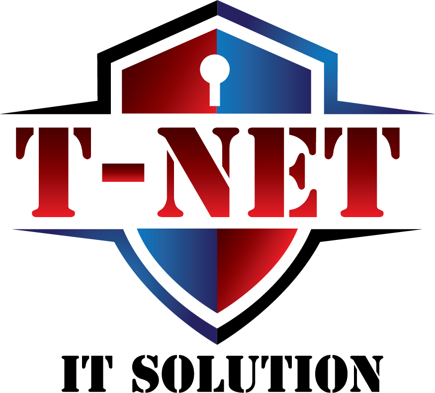

<p align="center">
  
</p>

# VulnPen

VulnPen is T-NET IT Solution's AI assistant for web application security testing. It plans and executes the OWASP WSTG v4.2 catalogue against a target, records the evidence, maps every finding to the OWASP Top 10:2025 and drafts the web application penetration testing report to the WSTG Reporting structure (version control, team, scope, limitations, timeline, disclaimer, findings and appendices). A Kali attack box provides the tooling; you describe the target and it works the plan. Progress is tracked per WSTG test case, and every finding is rated with the CVSS v3.0 base metrics (with the v2.0 and v4.0 scores derived from the same metrics) — severity is always derived from the score, never declared.

For authorised testing only — see the disclaimer at the end of this file.

## What It Does

- **Agentic execution** - the AI runs commands directly on the attack box, reads output, decides next steps, and loops. Up to 40 iterations per turn by default (configurable 5-200), no manual nudging required.
- **Web application security testing** - the assistant plans and works the OWASP WSTG v4.2 catalogue (97 test cases across 12 categories), records a result per test case, maps every finding to the OWASP Top 10:2025, and drafts the Web Application Penetration Testing Report. Every OWASP classification is a lookup of the finding's CWE in the CWE lists OWASP publishes — there is no curated crosswalk and no model in the path, so a report never claims a mapping the official sources do not support.
- **Agent tools** - bash, Python scripts, tool installation, shell management, Burp Suite (proxy history, Repeater, Intruder, Collaborator), browser automation, image reading, and the web application security testing tools (WSTG test plan, OWASP Top 10:2025 mapping, report generation).
- **Capability registry** - a curated registry of the security tools and Python packages a web-application engagement needs, each with its install command and a presence check. The agent installs what a test calls for on demand; the WSTG-recommended tools are all covered (see `backend/src/capabilities/registry.ts`).
- **Burp Suite integration** - proxy history viewer, send requests to Repeater/Intruder, Collaborator for out-of-band testing. All accessible to the agent and through the UI.
- **Browser agent** - real browser automation via [Magnitude](https://github.com/magnitude-dev/magnitude). Test login flows, fill forms, interact with JavaScript-heavy apps. Optionally proxy traffic through Burp. The agent drives the page through the DOM - elements are addressed by role and label, never by coordinate - so it needs no vision model and takes no screenshot in its action loop. Each action is settled and then verified: the agent waits for the page to stop reacting before it reads it, and reports what the page actually did rather than just that the click was dispatched, so a click that changes nothing says so instead of looking like a success. The browser runs **on the attack box**, so it shares that box's route to the target: the VPN connected there. The backend launches it over SSH and attaches over CDP through a loopback-only tunnel - nothing new is published on a network. Watch it on the attack box's desktop (the GUI page), where you can also take over by hand.
- **VPN management** - upload `.ovpn`/`.conf` bundles with referenced certificates, keys, or credentials and connect/disconnect from the browser. Multiple simultaneous connections supported.
- **Safety checks** - the boundary is the engagement target, never the attack box: the box is disposable test infrastructure the tester owns and can rebuild, so the rules point at the client's system rather than at the tester's own tooling. This is a proof-of-concept engagement by design: a destructive action against the target (an HTTP DELETE, destructive SQL such as DROP / TRUNCATE / DELETE FROM / mass UPDATE, sqlmap --os-shell or --file-write, a delete or disable endpoint, a raw request through Burp, a browser goal that deletes something) stops before it runs in every execution mode and is presented to the operator for approval - neither auto mode nor the per-user safety-protection setting can quietly carry it out in the agent's name. The agent is instructed to prove that a control is missing - never to carry the destructive step out. The same rules apply to a shell that lives on the target, where an `rm -rf /` costs the client a machine instead of the tester a rebuild.

  These checks read the command the agent is about to run, and that is their limit: the gate is a static read of the command, not a sandbox. An obfuscated or encoded form of the same action - shell substitution (`M=DELETE; curl -X $M`), a base64/hex payload piped into `sh`, an interpolated method name in Python, a destructive goal phrased in another language - is not always recognised. Measured against 61 known-destructive or out-of-scope vectors the gate stops 42 and misses 19 obfuscated variants, while none of the 13 benign vectors is stopped by mistake. Treat the operator approval step as a real control, not a formality.
- **Tool execution modes** - pick how the agent acts from the composer: **Auto run** (tools run; an action the system flags as crossing the approval boundary waits for the operator) or **Requires consent** (confirm every tool action). The choice is saved per user. Neither mode silently carries out a destructive action against the target — it stops for the operator first.
- **Composer model and reasoning pickers** - switch the orchestrator model and its reasoning effort (off / low / medium / high / xhigh / max) inline from the chat composer, across any model registered under Settings -> Models.
- **Bring your own model** - OpenAI, Anthropic (API key or OAuth), Google, Mistral, or any OpenAI-compatible endpoint.
- **Use existing local subscriptions** - VulnPen can use an authenticated Codex CLI in Docker or host mode, and Claude Code in host/developer mode, as normal inference providers while retaining its own tool and consent loop.

## Web Application Security Testing

VulnPen's assistant is built around web application security testing. It executes the OWASP Web Security Testing Guide v4.2 methodology and reports findings against the OWASP Top 10:2025.

- **Test plans from the WSTG v4.2 catalogue** - all 97 test cases across the 12 WSTG categories (Information Gathering, Configuration and Deployment, Identity Management, Authentication, Authorization, Session Management, Input Validation, Error Handling, Cryptography, Business Logic, Client-side, API). The plan covers the full catalogue by default; restrict it to specific categories or hand-pick individual cases in the **Plan setup** dialog when the scope is narrower. Every case carries its WSTG id, section, objective, method and the evidence expected from it.
- **Per-case execution and tracking** - the plan is stored in the session and re-injected into the system prompt on every turn, so coverage survives context summarisation. Results are `passed`, `failed`, `blocked`, `in progress`, `skipped` or `not started`; a case that was never run is never reported as passed.
- **Findings mapped to the OWASP Top 10:2025** - the finding's CWE is looked up in the CWE lists OWASP publishes for the ten 2025 categories. Those lists are disjoint, so the classification is a single-valued, deterministic lookup: no heuristic, no curated crosswalk, no model. Findings whose CWE is missing or is not in any published list are reported as *unmapped* instead of guessed, and the rationale plus its official source are stored on the finding.
- **Draft report** - a Web Application Penetration Testing Report (document control, executive summary, scope and methodology, risk summary by severity and by Top 10 category, findings summary and detail, WSTG v4.2 coverage with untested and blocked cases, OWASP Top 10:2025 mapping, remediation roadmap, appendices) generated deterministically from the evidence the session already holds. The document is generated in **Thai** - the section headings and body prose are part of the template, and there is no locale option yet, so an engagement delivered in another language needs the draft translated before it goes out.

| Surface | What it does |
| --- | --- |
| Agent tools | `wstg_test_plan` (generate, list, get, update_case, coverage), `map_finding_owasp`, `generate_pentest_report` |
| Slash commands | `/wstg [target]` (plans the full WSTG catalogue; ask the assistant to restrict categories or add custom cases), plus the chat-side commands with no page or tool behind them (`/summarize`, `/shells`, `/reset`, `/help`) |
| Session UI | **WSTG Test Plan** view: one **Plan setup** dialog (target, scope, notes and the WSTG categories to cover, with a keep/add/drop preview before saving), a progress bar with the status counts as clickable filters, the cases grouped into collapsible WSTG categories (complete a category in one click), a result control per case with the method and expected evidence on expand, edit and single or selection removal, and the report draft with markdown download |
| REST API | `GET`/`POST` `/agent/session/:id/test-plan` (`action`: `generate` for the plan setup dialog, `add_case` to complete a category), `PATCH`/`DELETE` `/agent/session/:id/test-plan/cases/:testId`, `POST /agent/session/:id/test-plan/cases/remove`, `GET /agent/session/:id/report` (add `?download=1` for markdown), `POST /agent/session/:id/vulnerabilities/:vulnId/map`, `POST /agent/session/:id/vulnerabilities/map-all` |

## Quick Start

```bash
git clone <repository-url>
cd <repo-directory>
./run.sh start
```

Open `http://localhost:3000`, register, and start a session.

`run.sh` waits for the frontend, backend, MongoDB, and Redis to be ready before
reporting success. If startup fails, it prints the affected container status and
recent logs. Configure and assign a model under **Settings -> Models** after the
first start.

On Windows, run VulnPen inside WSL2 with Docker Desktop's WSL
integration enabled. Native PowerShell and Windows SSH work hosts are not
supported because workspace commands require a POSIX shell. For reliable file
permissions and performance, clone the repository into the WSL filesystem, not
under `/mnt/c`.

### Codex and Claude subscription inference

Settings -> Models detects authenticated Codex and Claude Code CLIs. Authenticate
once on the machine that runs the CLI:

```bash
codex login
claude auth login
```

Then select **Use Codex** or **Use Claude Code**. The official CLI owns login,
refresh, and subscription entitlement handling; VulnPen does not copy
or replay OAuth tokens. Subscription transports receive the same conversation
history and function schemas as API providers and return the same assistant/tool
call contract, so VulnPen continues to execute tools and consent checks.

The Docker backend includes the Linux Codex CLI and mounts only the host's
file-based `~/.codex/auth.json`, following Codex's documented headless/Docker
login transfer flow. Set `CODEX_AUTH_FILE` before `docker compose up` if your
credential file lives elsewhere. The CLI may refresh that file during normal
use; never commit or share it. Host Keychain-only credentials and Claude Code
remain available only in developer/host mode until a host inference bridge is
configured. Claude subscription use is local CLI control and must comply with
Anthropic's current third-party product and subscription terms.

Current first-class model families include GPT-5.6 Sol/Terra/Luna, Claude
Fable/Opus/Sonnet 5, and Kimi K3 (direct Moonshot API or OpenRouter).

### Workspace-scoped SSH profiles

In Docker mode, VulnPen mounts the host's `~/.ssh` and `~/keys`
directories read-only. Each workspace can select a concrete `Host` alias from
`~/.ssh/config` under **Connection**. Every session in that workspace uses the
same host and work folder without copying private keys into MongoDB. Set
`HOST_SSH_DIR` or `HOST_SSH_KEYS_DIR` before starting Docker when those
directories live elsewhere.

Use named aliases rather than wildcard-only entries:

```ssh-config
Host lab-box
  HostName 10.10.10.10
  User root
  IdentityFile ~/.ssh/lab-box.pem
```

`run.sh` handles config file generation, Docker builds, and container orchestration. Use `./run.sh start -q` to reuse the previous launch mode and skip prompts on subsequent runs.

For the complete OS, Docker, SSH, VPN, proxy, permissions, recovery, and
deployment scenario matrix, see **[Setup and Troubleshooting](./docs/SETUP.md)**.

```bash
./run.sh stop       # Stop all containers
./run.sh logs       # Tail logs
./run.sh status     # Container status
./run.sh backup     # Back up databases, configuration, and workspaces
./run.sh config     # Update configuration
./run.sh dev        # Developer mode (infra only, run frontend/backend locally)
./run.sh help       # Full help
```

### System Requirements

|         | Minimum                                           |
| ------- | ------------------------------------------------- |
| RAM     | 8 GB (+2 GB if using the built-in Kali container) |
| Disk    | 20 GB                                             |
| Docker  | v20+ with Compose v2+                             |
| Node.js | v22+ (dev mode only)                              |
| pnpm    | v9+ (dev mode only)                               |

Docker mode binds its UI and service ports to `127.0.0.1` by default. Do not
expose the stack to a LAN or the internet without TLS, authentication, and a
deliberate reverse-proxy configuration. In the built-in Kali mode, keep durable
workspace files under `/kali-data`; files elsewhere in the Kali container are
removed when the container is recreated.

## Documentation

The in-repository **[Setup and Troubleshooting guide](./docs/SETUP.md)** is the
authoritative source for installation, configuration, recovery, and deployment.

## Local Development

```bash
./run.sh dev    # Starts MongoDB + Redis in Docker
```

Then in separate terminals:

```bash
cd backend && pnpm install && pnpm run watch   # TypeScript compiler
cd backend && pnpm run dev                     # Backend server (port 8080)
cd frontend && pnpm install && pnpm run dev    # Frontend (port 3000)
```

For development setup and troubleshooting, see the
[Setup and Troubleshooting guide](./docs/SETUP.md).

## Authors

VulnPen is developed by **T-NET IT Solution**.

## Contributing

Contributions welcome. See the [Contributing Guide](./CONTRIBUTING.md) and [Code of Conduct](./CODE_OF_CONDUCT.md).

## License

[MIT License](./LICENSE)

## Disclaimer

VulnPen is intended for authorized security testing only. Always have explicit permission before testing any system.
